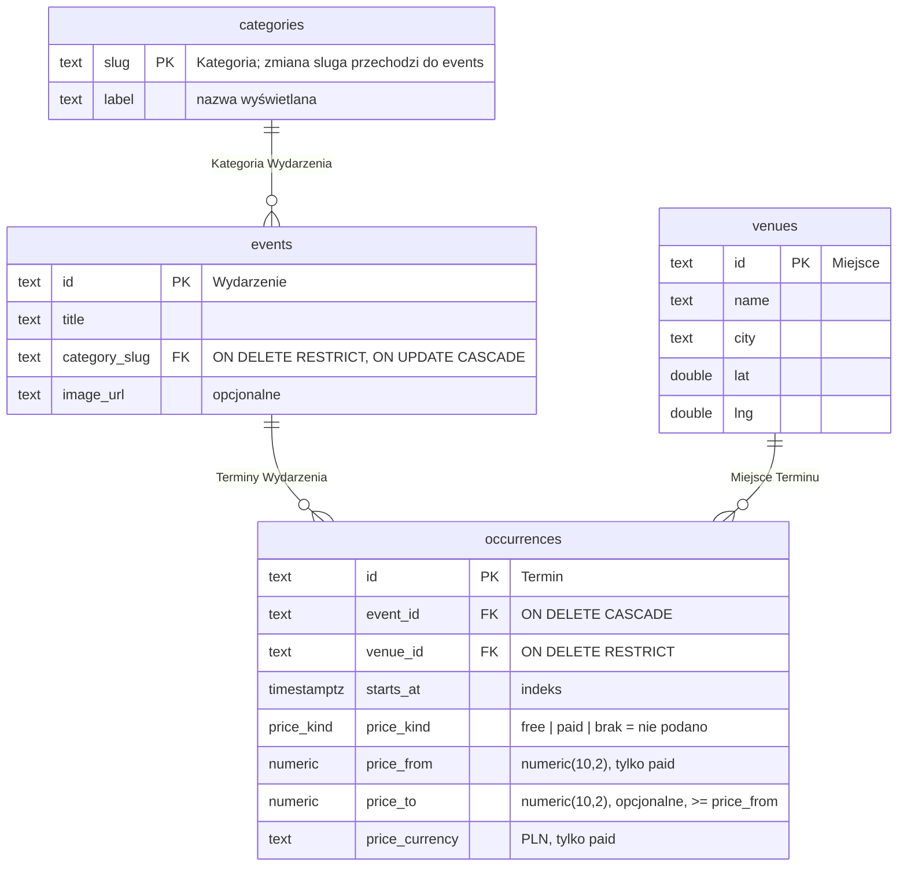

# Schemat bazy danych

Postgres, jeden schemat na kontekst (ADR-0002). Tabele definiuje Drizzle w `apps/api/src/contexts/<kontekst>/schema.ts` (ADR-0009), migracje są w `apps/api/drizzle/`. Diagram aktualizujemy w każdym kroku, który zmienia schemat.

## Schemat `events` (kontekst Wydarzenia)

- Cena: CHECK `occurrences_price_valid` dopuszcza trzy stany — brak ceny (wszystkie kolumny ceny puste), `free` (kwoty i waluta puste), `paid` (`price_from >= 0`, waluta `PLN`, `price_to` puste albo `>= price_from`). Ta sama reguła jest w `priceSchema` w `@events/contract`.
- Indeksy: `occurrences.starts_at` oraz każdy klucz obcy.
- Daty: `starts_at` to `timestamptz`; API zwraca je jako czas Europe/Warsaw (`toWarsawIso`).
